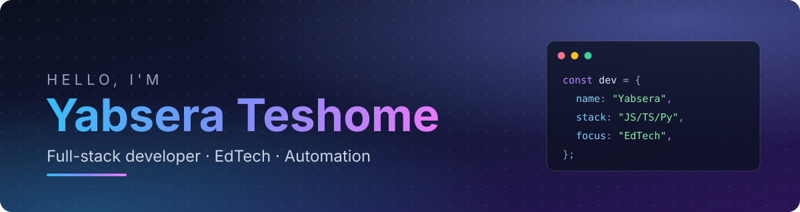
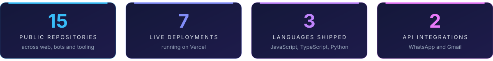

  

  

  
  
  

## About

I build practical software that solves real operational problems: learning platforms delivered over WhatsApp, email and campaign tooling, analytics dashboards and polished portfolio sites. I like owning a product end to end, from the data layer and API to a deployed interface that people enjoy using.

<table>
  <tr>
    <td width="50%" valign="top">

**Focus**
- EdTech and learning experiences
- Workflow automation
- Conversational interfaces
- AI-assisted applications

</td>
    <td width="50%" valign="top">

**Approach**
- Ship early, iterate with real users
- Clean UI with strong attention to detail
- Persistent data and reliable deployments
- Documentation that people can follow

</td>
  </tr>
</table>

## Highlights

  

## Technical Stack

    
    
  

## Featured Projects

<table>
  <tr>
    <td width="50%" align="center">
      
       WhatsApp learning bot with a real-time admin dashboard
       <a href="https://portal-six-sepia-65.vercel.app"><b>Live demo</b></a>
    </td>
    <td width="50%" align="center">
      
       Gmail inbox, branded replies and batch campaigns
       <a href="https://erp-agents.vercel.app"><b>Live demo</b></a>
    </td>
  </tr>
  <tr>
    <td width="50%" align="center">
      
       Personal portfolio built with Next.js and TypeScript
       <a href="https://update-portfolio-eosin.vercel.app"><b>Live demo</b></a>
    </td>
    <td width="50%" align="center">
      
       Python serverless app for digital learning
       <a href="https://digital-pedagogy.vercel.app"><b>Live demo</b></a>
    </td>
  </tr>
  <tr>
    <td width="50%" align="center">
      
       Python serverless app on Vercel
       <a href="https://mindsmith-nine.vercel.app"><b>Live demo</b></a>
    </td>
    <td width="50%" align="center">
      
       Python serverless app on Vercel
       <a href="https://elexir-indol.vercel.app"><b>Live demo</b></a>
    </td>
  </tr>
</table>

## Achievements

  

## GitHub Activity

  
  

  

  <picture>
    <source media="(prefers-color-scheme: dark)" srcset="https://raw.githubusercontent.com/yabumac/yabumac/output/github-snake-dark.svg" />
    <source media="(prefers-color-scheme: light)" srcset="https://raw.githubusercontent.com/yabumac/yabumac/output/github-snake.svg" />
    
  </picture>

## Get in Touch

  
  

Open to collaboration on education, automation and product work.

